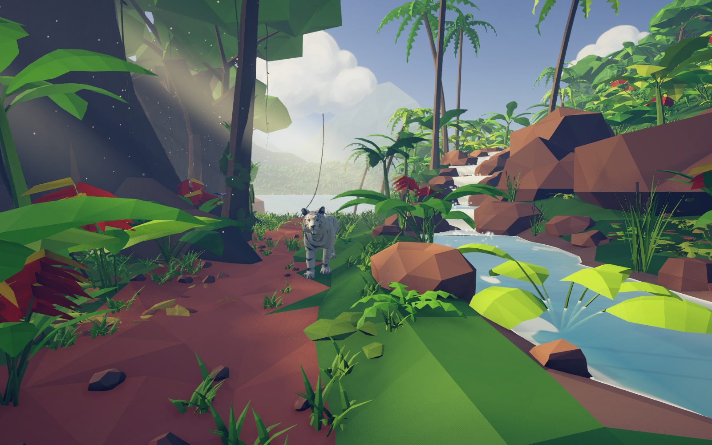
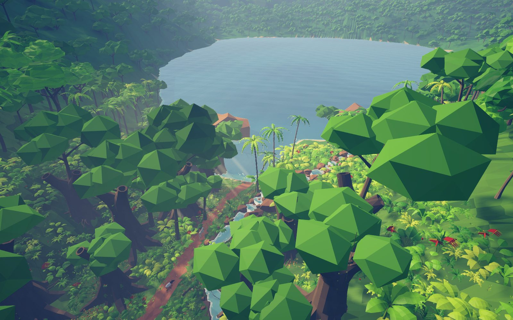
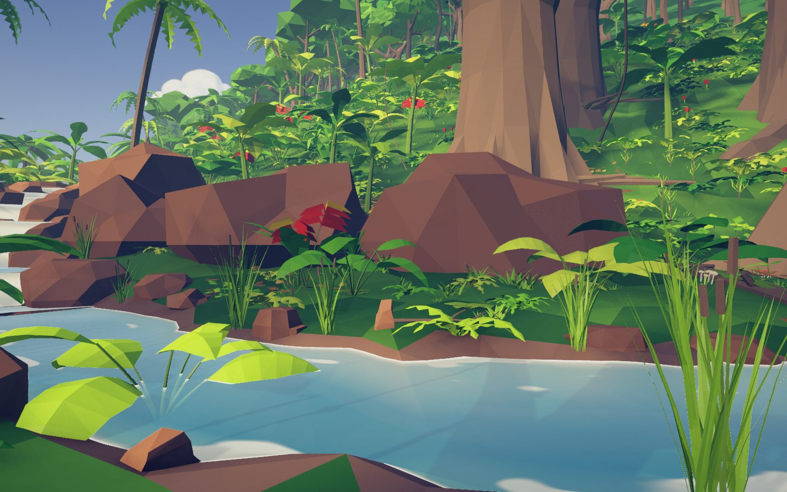
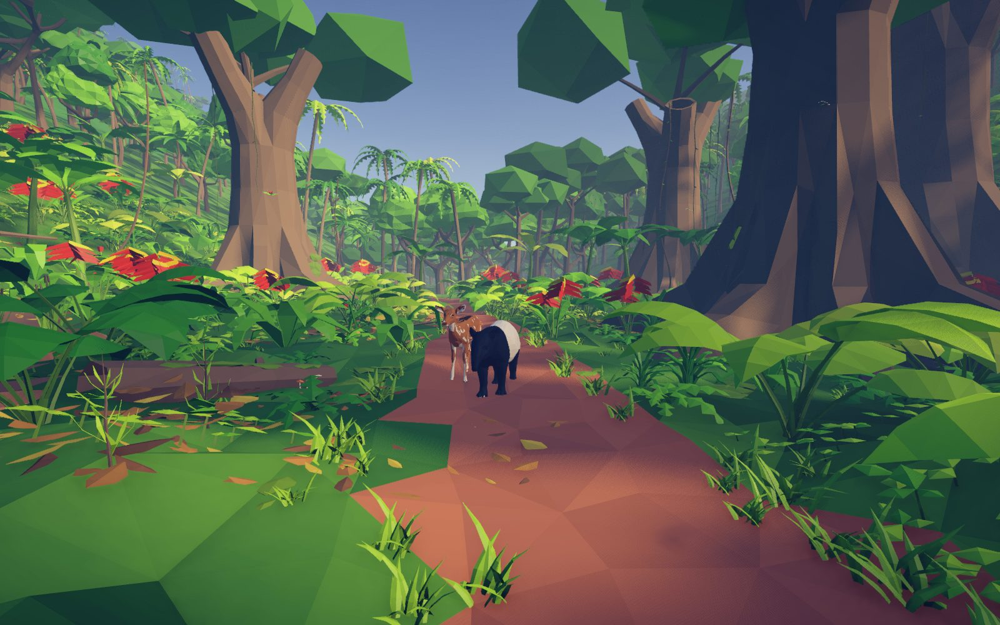
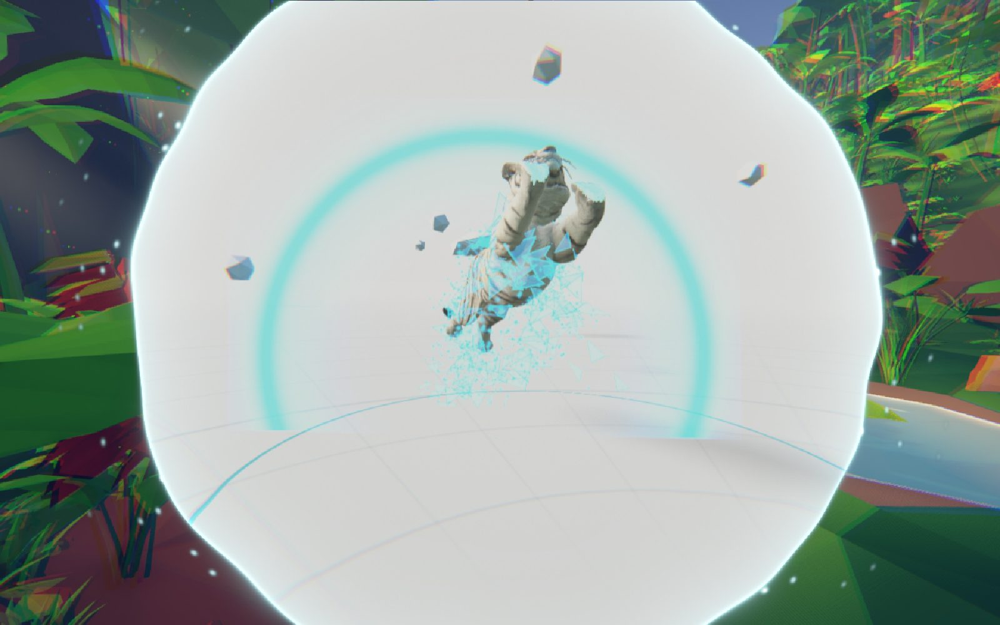
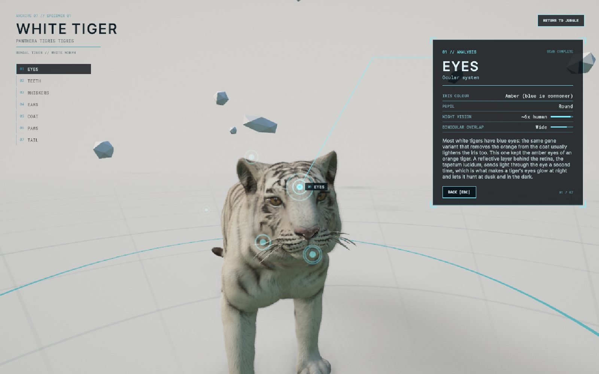
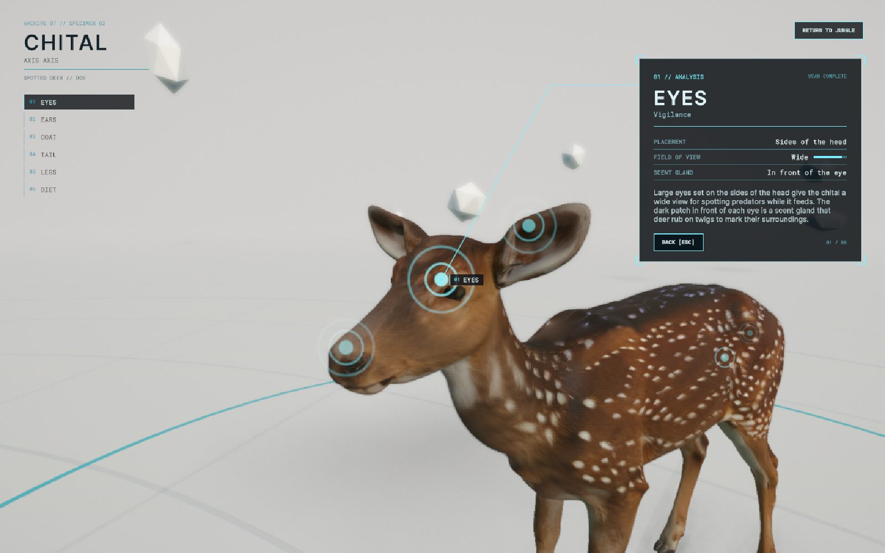
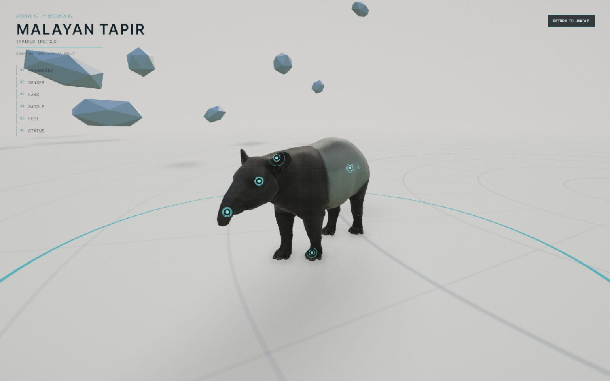

# Terra Remastered

A low-poly tropical rainforest in **Unity 6 (URP)**: you stand on a jungle path and look around. A white tiger paces
the path in front of you, and a Malayan tapir and a chital doe walk the path behind you. Click an animal and it is
pulled through a portal into a white studio, where it turns photoreal and can be explored point by point.

Everything (assets, scene, animation, lighting, tests) was built by Claude Code through scripts: Blender Python for
the assets, generated C# for the scene, AI generation for a few hero models.



| | |
|---|---|
|  |  |
|  |  |
|  |  |



## What's in it
- **The vista**: faceted terrain, a lake, a stream with stepped cascades, ridges and mountains out to 3 km, about
  4,000 plants and rocks near the viewer and a sunk canopy on the hills. Baked GI with a shadowmask sun, soft dappled
  shadows, SSAO, volumetric fog and light shafts.
- **Life**: butterflies around the heliconias, a bird flock crossing the sky, splash at the cascades, gust fronts
  moving through the foliage, drifting cloud shadows on the far hills, epiphytes and lianas on the giant trunks.
- **Animals**: a white tiger, a Malayan tapir and a chital, each with an Idle / Walk set of clips and a per-joint
  locomotion layer (planted paws, two-bone leg IK, body following the terrain, tail lag), ear flicks, tail swishes and
  footsteps. They stop and watch you when you look at them for a moment.
- **Portal encounters**: the tiger charges and leaps through a portal; the prey animals look up and the camera glides
  through the portal to them. The low-poly animal turns into its HD twin exactly where the portal rim passes over it.
- **White studio showcase**: orbit the HD animal (shell fur on all three), click a point of interest (eyes, teeth,
  coat, feet, ...) and the camera flies there and opens an info panel with facts.
- **No overlaps**: a scene-wide pass makes sure no plant grows through another and nothing stands in an animal's way
  (checked against recorded body sweeps of each animal).

## Controls
| | |
|---|---|
| Look around | click into the Game view to capture the mouse, then move it (arrows / WASD / right stick also work); Esc releases |
| Make an animal notice you | keep the reticle on it for about a second |
| Portal encounter | click the animal under the reticle |
| White studio | drag to orbit, scroll to zoom, click a point (or the list on the left); Esc / right click goes back; RETURN TO JUNGLE reloads the forest |

## Run it
Open `UnityProject/` in **Unity 6000.6** (URP 17), open `Assets/Scenes/Rainforest.unity` and press Play. The large
binaries (models, textures, lightmaps) are in Git LFS: run `git lfs install` before cloning.

A macOS player build: `tools/unity_run.sh unity/build_player.cs` (→ `UnityProject/Builds/`). Performance on an Apple M4
at 1920x1080: 8.7 ms per frame on average, 13.0 ms in the busiest view (77 fps), up to 8 ms in the fur close-ups
(`docs/perf.md`).

## How it was made
| Piece | How |
|---|---|
| Plants, palms, trees, rocks, epiphytes, reeds, lily pads | procedural Blender Python, `blender/lib/veg.py` + `blender/assets/Vegetation/build.py` |
| Buttress-root giant tree | AI: Nano Banana Pro concept → Hunyuan 3D V3 (low-poly), via Figma Weave (`sources/weave/`) |
| Clouds | AI: Nano Banana Pro image on `CloudCard` shader cards |
| HD tapir and chital | AI: Nano Banana Pro photo → Hunyuan 3D V3 (textured); rig fitted to the HD mesh, the low-poly twin decimated from it (`blender/lib/quadruped.py`) |
| White tiger | user-supplied low-poly and HD models, rigged and animated in Blender (`blender/assets/WhiteTiger*/`) |
| Extra plants and rocks | CC0 packs: Quaternius Ultimate Nature, Kenney Nature Kit (`UnityProject/Assets/ThirdParty/`) |
| Terrain, lake, stream, mountains, the whole scene | generated by `UnityProject/Assets/Scripts/Editor/RainforestBuilder*.cs` (deterministic) |
| Shaders | `LowPolyLit`, `LowPolyFoliage`, `LowPolyWater`, `FurShell`, `Portal`, `VolumetricFog`, ... in `Assets/Shaders/` |
| HUD | UI Toolkit with Inter (OFL) and Roboto Mono (Apache 2.0) |
| Ambience and footsteps | procedural (`sources/audio/gen_audio.py`, `Footsteps.cs`) |

**Rebuild the scene** from code: `tools/rebuild_scene.sh` (full: placement, the overlap pass, a lighting bake and the
fixed captures, about 35 min) or `QUICK=1 NO_BAKE=1 tools/rebuild_scene.sh` while iterating (about 1 min).
Checks: `unity/encounter_test.sh` (`SPECIES=tiger|tapir|chital`), `unity/life_test.sh`, `unity/play_test.sh`,
`unity/motion_test.sh` (paw slip / pops), `unity/clearance_audit.cs` (overlaps, animal contacts). The working log,
with every decision and measurement, is `docs/SESSION_LOG.md`; lessons learned are in `docs/LESSONS.md`.

This repository is a snapshot; the development history is kept separately.

---

## Pipeline (from the Unity build template)

A starting point for projects that create 3D assets and build scenes in Unity 6 (URP), with Claude Code doing most
of the work through scripts. Assets are built in Blender with Python, or generated with Tripo. They are checked
numerically and visually, exported with LODs and collision, and imported into Unity by fixed rules. This setup came
out of a larger Blender → Unity project; its lessons are in `docs/LESSONS.md`.

```
 idea / spec (PROJECT.md)
   ├─ hand-built:  blender/assets/<Name>/build.py ─┐
   └─ generated:   tools/tripo_make.sh → ingest ───┤  tools/blender_run.sh  (headless or live Blender)
                                                   ▼
          audit (numbers) → review renders (fixed views) → export (FBX LOD0-2 + UCX + GLB + manifest)
                                                   ▼
          tools/sync_to_unity.sh → AssetImportRules + unity/import_assets.cs → PF_<Name> prefab
                                                   ▼
          placement → unity/audit_scene.cs → unity/capture.cs → lighting/occlusion bake → PerfBench in a build
```

### Requirements
| Tool | Version used | Notes |
|---|---|---|
| Blender | 5.1 | headless runs need nothing else; live runs need the Blender MCP add-on |
| Unity | 6000.6 (Unity 6.6), URP 17 | project in `UnityProject/`; `com.unity.pipeline` enables `unity command` |
| Unity CLI | `~/.unity/bin/unity` | drives the open editor (`eval_file`, `job wait`) |
| Tripo CLI | 0.7+ | `npm i -g tripo-cli`, then `tripo login --region ov` |
| Python 3 + uv | | texture scripts (`numpy`, `pillow`, `scipy` via `uv run`) |
| git + git-lfs | | LFS rules are in `.gitattributes` |
| HfG AI Hub key | | for AI textures; in `.claude/settings.local.json` (see the `.example`) |

### Start a new project
```bash
tools/new_project.sh ~/Dev/my-project "My Project"
cd ~/Dev/my-project
# 1. Open UnityProject/ in Unity 6.6, then Tools > Asset Pipeline > Setup Project (URP asset, linear, text serialization, ...)
# 2. Fill in PROJECT.md: brief, budgets, art direction, material library
# 3. Check the tools:
tripo doctor
ASSET=Crate tools/blender_run.sh blender/assets/Crate/build.py          # example asset: build, audit, review, export
tools/sync_to_unity.sh Props Crate                                       # into Unity (the editor must be open)
```
Machine paths (Blender, Unity CLI, Unity project) are in `.env` (copied from `.env.example`).

### Layout
| Path | What |
|---|---|
| `CLAUDE.md` | working rules for Claude in this project |
| `PROJECT.md` | the brief: target, budgets, art direction (fill in) |
| `.claude/skills/` | `blender-assets`, `tripo-ai-models`, `asset-pipeline`, `unity-project-structure` (+ scripts for AI textures) |
| `blender/lib/` | `kit.py` (modelling helpers), `export.py` (masks, LODs, UCX, FBX/GLB), `audit.py`, `review.py` |
| `blender/scripts/` | `stages.py` (audit/review/export any asset), `ingest_mesh.py` (Tripo/external meshes), `lod_regen.py`, `uv_audit.py` |
| `blender/assets/<Name>/` | one folder per asset: `build.py` + `.blend` (example: `Crate`) |
| `blender/export/` | generated exports (git-ignored) |
| `sources/` | Tripo generations (`tripo/<Name>/`, `LOG.tsv`) and reference images |
| `textures/` | AI texture sets: raw images, `gen.sh` with prompts, derived PBR maps |
| `tools/` | shell entry points (see below) |
| `unity/` | C# eval scripts for the open editor; `args/` inputs, `reports/` outputs |
| `UnityProject/` | the Unity project (`Assets/README.md` for its layout) |
| `docs/` | `LESSONS.md`, `CHECKLISTS.md`, `SESSION_LOG.md`, `perf.md` |
| `renders/` | review renders and Unity captures (git-ignored) |

### Tools
| Command | Does |
|---|---|
| `tools/blender_run.sh [--live] <step.py> [file.blend]` | runs a step with the libs prepended; prints `RESULT_JSON` |
| `tools/tripo_make.sh <Name> "<prompt or image>" [flags]` | dry-run, then generate into `sources/tripo/<Name>/`, log credits (`DRY=1` = plan only) |
| `tools/sync_to_unity.sh <Category> <Name> ...` | copy exports into `Assets/Art/...` and run the Unity import step |
| `tools/unity_run.sh unity/<script>.cs [args]` | run an eval script in the open editor (`COMPILE_ONLY=1` to check it compiles) |
| `tools/sheet.py out.png imgs...` | contact sheet for review rounds |
| `tools/new_project.sh <dir> [name]` | new project from this template |

### Unity side
- `Assets/Scripts/Editor/ProjectPaths.cs`: where everything lives (no hard-coded folders anywhere).
- `AssetImportRules.cs`: import settings for `SM_`/`SK_` models and `T_` textures, applied automatically.
- `AssetPipeline.cs`: prefab builder (LODGroup, UCX colliders, static flags), material creation and remap, scene problems.
- `ProjectSetup.cs`: one-time setup (URP asset, linear colour, Force Text, Run In Background, Frame Timing Stats).
- `Scripts/Runtime/Dev/PerfBench.cs`: benchmark in player builds (`-perfbench`, views under a `PerfViews` object).

### What was verified when the template was made
The Crate example was built, audited, rendered and exported with Blender 5.1. LOD regen, UV audit and mesh ingest
ran on its files. The Unity scripts compiled in Unity 6000.6.0f1. With an editor running, the full loop was exercised:
sync, import, materials and prefab, a scene audit that caught a planted floating crate, an overlap and a blocked
walk route, and a capture. Tripo was checked with dry runs only, so no credits were spent.
